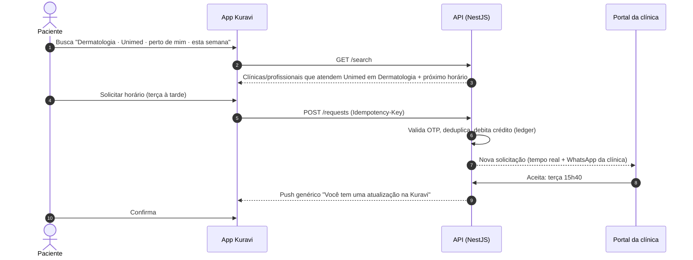
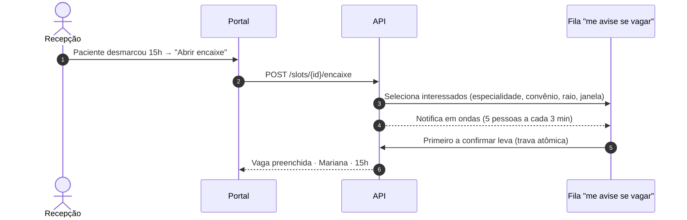

# 01 · Produto

## Visão

**Kuravi conecta pacientes a médicos, clínicas e laboratórios que realmente atendem o seu convênio (ou particular), com horário confirmado em minutos, sem ligação e sem espera no WhatsApp.**

Para a clínica, a Kuravi é um canal de novos pacientes que só cobra por resultado e uma ferramenta para preencher horários vagos (Modo Encaixe).

## Problema

| Para quem | Dor | Evidência a coletar na Fase 0 |
|---|---|---|
| Paciente com convênio | Não sabe **quem atende o plano dele naquela especialidade**. A lista do convênio está desatualizada; liga, ouve "não atendemos mais esse plano", recomeça. | Entrevistas, tempo médio até agendar |
| Paciente particular | Não sabe preço nem disponibilidade sem perguntar um por um | Entrevistas |
| Recepção da clínica | WhatsApp lotado de "tem horário?", repetindo as mesmas perguntas; dados de convênio chegam incompletos | Observação de 2 a 3 recepções |
| Gestor da clínica | **Horários vagos** por desmarcação em cima da hora e faltas (no-show); custo de aquisição alto no Google/Instagram | Taxa de no-show e de ocupação da agenda |

## Personas

1. **Mariana, 32, paciente com convênio.** Trabalha em horário comercial, resolve tudo pelo celular, odeia ligar. Quer "dermato pelo meu plano, perto do trabalho, nesta semana".
2. **Seu Antônio, 64, paciente particular e cuidador.** Marca consultas para si e para a esposa (dependente). Quer letra grande, poucos passos e confirmação clara.
3. **Cláudia, 41, recepcionista.** Atende telefone, WhatsApp e balcão ao mesmo tempo. Quer receber solicitações **completas** (convênio, carteirinha, horário preferido) e responder com um toque.
4. **Dr. Rafael, 38, dermatologista com consultório próprio.** Sem recepção dedicada; quer encher os buracos da agenda sem pagar mensalidade.
5. **Fernanda, 45, gestora de clínica multiespecialidade.** Olha ocupação, faltas, custo por paciente e retorno do investimento em marketing.

## Proposta de valor

| Paciente | Clínica |
|---|---|
| Vê **quem atende o seu plano nessa especialidade**, de verdade | **Pacientes novos sem mensalidade**: só paga por Solicitação Verificada |
| Vê o **próximo horário disponível** e pede em poucos toques | Solicitações **completas** (convênio, horário, documentos), sem pingue-pongue no WhatsApp |
| Recebe confirmação e lembretes | **Modo Encaixe**: preenche um cancelamento em minutos |
| Faz o **pré-check-in**: envia carteirinha e documento antes de sair de casa | **Pré-check-in**: recepção mais rápida, menos fila |
| Pode pedir "me avise se vagar antes" | Menos faltas, com lembretes e confirmação ativa |

## Diferenciais (o que um concorrente não copia fácil)

1. **Matriz convênio × especialidade × profissional**, mantida pela própria clínica e confirmada a cada solicitação. A pergunta "atende Unimed para dermatologia com a Dra. X?" tem resposta precisa, não "atende Unimed" genérico.
2. **Modo Encaixe** com fila de interessados: a vaga aberta notifica, por ordem, quem pediu "me avise se vagar antes" naquela especialidade, convênio e região.
3. **Cobrança por desempenho verificável** (Solicitação Verificada), em vez de mensalidade.
4. **Conformidade como produto:** perfis com CRM/RQE verificados, ranking transparente, notificações que não expõem a especialidade (sigilo).

## Escopo do MVP (Fase 1)

### App do paciente (Flutter · iOS e Android)

| Prioridade | Funcionalidade |
|---|---|
| **Must** | Cadastro por telefone com código (OTP), perfil e dependentes |
| **Must** | Cadastrar convênio (operadora + plano) ou "particular" |
| **Must** | Busca por especialidade/exame + convênio + localização (raio) + período |
| **Must** | Perfil do profissional/clínica: CRM/UF, RQE, convênios por especialidade, endereço, horários de atendimento |
| **Must** | **Solicitar horário** (gera Solicitação Verificada) e acompanhar o status |
| **Must** | Confirmação, lembrete D-1 e opção de cancelar/remarcar |
| **Must** | Consentimentos LGPD granulares + central de privacidade (exportar/excluir dados) |
| **Should** | "Me avise se vagar antes" (entra na fila do Modo Encaixe) |
| **Could** | Pré-check-in (foto da carteirinha e documento) |
| **Won't (MVP)** | Pagamento online, telemedicina, prontuário, avaliações públicas |

### Portal da clínica (web)

| Prioridade | Funcionalidade |
|---|---|
| **Must** | Cadastro com verificação: CNPJ, CNES, diretor técnico (CRM), profissionais (CRM/RQE) |
| **Must** | Matriz convênio × especialidade × profissional |
| **Must** | Caixa de solicitações: **aceitar com horário**, propor outro horário ou recusar, com SLA visível |
| **Must** | Créditos: saldo, extrato, teto diário, contestação em 72 h |
| **Must** | Usuários e papéis (gestor, recepção, profissional) com MFA |
| **Should** | Agenda simples (slots publicados) |
| **Should** | **Modo Encaixe v1**: publicar vaga → notificar a fila → primeiro que confirmar leva |
| **Could** | Relatórios: solicitações, conversão, custo por paciente |

### Backoffice Kuravi (interno)

Aprovação de cadastros, moderação, suporte, contestações, gestão de créditos e auditoria.

## Jornadas principais

### Paciente: encontrar e solicitar

### Clínica: Modo Encaixe

## Métricas

**North Star:** **consultas realizadas via Kuravi por semana** (o paciente compareceu).

| Métrica de entrada | Meta inicial (hipótese) |
|---|---|
| Clínicas ativas (≥ 1 solicitação respondida/semana) | 50 no fim da Fase 1 |
| Tempo mediano de resposta da clínica | ≤ 30 min em horário comercial |
| Solicitação → consulta confirmada | ≥ 50% |
| Consulta confirmada → realizada (show-up) | ≥ 85% |
| Preenchimento do Modo Encaixe | ≥ 40% das vagas abertas |
| Taxa de contestação de solicitações | ≤ 5% |
| Custo de aquisição (CAC) de paciente | ≤ R$ 15 |

## Cidade piloto

Ainda não definida. Proposta de critérios com peso:

| Critério | Peso | Como medir |
|---|---|---|
| Rede de contatos dos fundadores com clínicas | 30% | Nº de clínicas que topam conversar |
| % da população com plano de saúde | 20% | Dados públicos da ANS por município |
| Densidade de clínicas privadas por km² | 20% | CNES (DataSUS) |
| Concorrência local (Doctoralia, BoaConsulta etc.) | 15% | Nº de perfis ativos nas especialidades-alvo |
| Custo de mídia local | 15% | Teste de anúncio |

Especialidades iniciais sugeridas (alta demanda e espera longa): **dermatologia, ginecologia, oftalmologia, ortopedia, pediatria** e **exames de imagem**. Especialidades sensíveis (psiquiatria, infectologia, oncologia) ficam para depois, com cuidados extras de privacidade.

## Go-to-market (clínicas primeiro)

O site é **funil B2B**: o objetivo número 1 é o pré-cadastro de clínicas. Pacientes entram numa lista de espera secundária.

1. **Oferta antes da demanda:** 30 a 50 clínicas na cidade piloto, nas especialidades iniciais, antes de investir em mídia para pacientes.
2. **Venda consultiva:** visita + demonstração do portal + 10 solicitações grátis.
3. **Demanda:** SEO local programático (páginas "dermatologista que atende Unimed em {bairro}"), blog no Directus, Google Ads com orçamento controlado, parcerias com empresas (RH).
4. **Prova:** relatório mensal para a clínica com solicitações, consultas e custo por paciente.

## Concorrência (para posicionamento)

| Player | Modelo | Nosso ângulo |
|---|---|---|
| Doctoralia (Docplanner) | Assinatura do profissional + agenda | Sem mensalidade; matriz convênio × especialidade; Modo Encaixe |
| BoaConsulta, Medprev, dr.consulta | Marketplace/rede própria, foco em particular popular | Foco em **convênio + particular** e em clínicas independentes |
| HiDoctor® (Centralx) | Software de consultório com agendamento online | Somos canal de aquisição + agenda leve, não prontuário |
| Busca no Google / Instagram | Mídia paga pela clínica | Custo por paciente previsível e menor |
