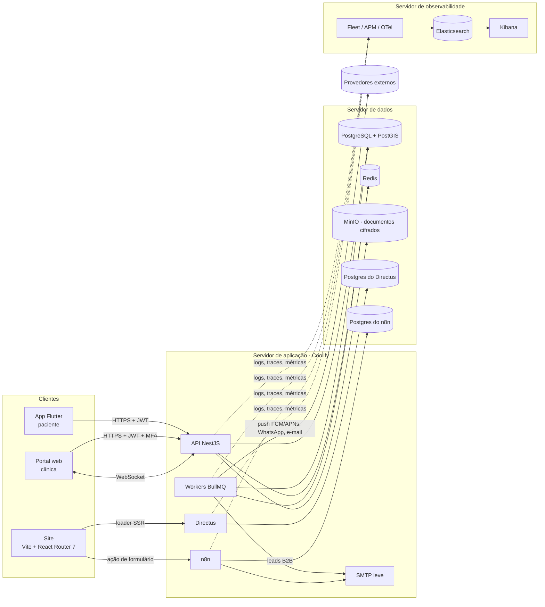
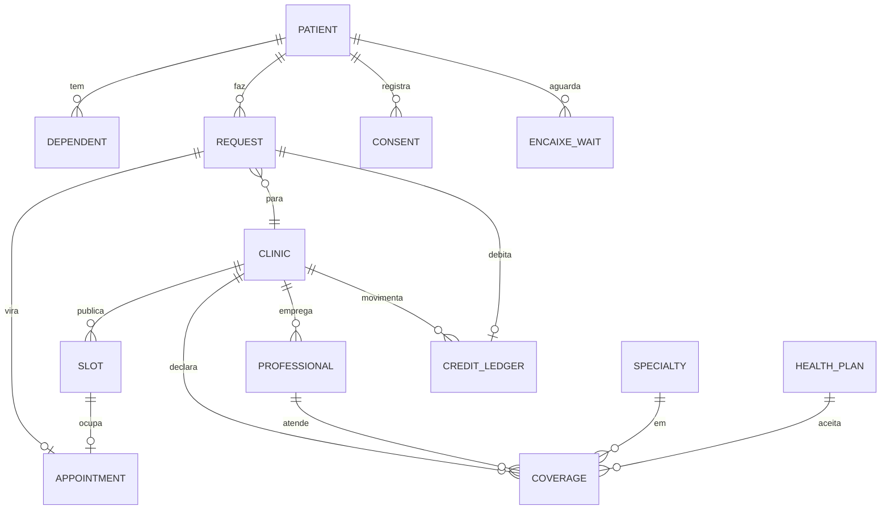

# 02 · Arquitetura

## Princípios

1. **Mesma stack do integriguard.tech**, para reaproveitar conhecimento, componentes e operação.
2. **Chato por padrão:** um monólito modular em NestJS + PostgreSQL resolve o MVP. Microsserviços só quando houver dor medida.
3. **Dados de saúde nunca saem do perímetro principal:** CMS, n8n, logs e analytics recebem só o mínimo necessário, pseudonimizado.
4. **n8n fora do caminho crítico:** agendamento, cobrança e notificações transacionais rodam na API. O n8n cuida de formulários do site, operações e marketing.
5. **Tudo no Coolify**, em servidores no Brasil.

## Stack

| Camada | Tecnologia | Observações |
|---|---|---|
| **Protótipo do site (agora)** | HTML + CSS + JavaScript puro | Validar conceito e identidade. Pasta [`/prototype`](../prototype) |
| **Site (produção)** | **Vite + React Router 7** (modo framework, SSR) + TypeScript + **Tailwind CSS v4** | Igual ao integriguard.tech: fontes hospedadas no próprio site, CSP com nonce, JSON-LD, sitemap |
| **Blog / conteúdo** | **Directus** (headless CMS) | Banco próprio, separado do banco da aplicação. Só conteúdo público |
| **Formulários e automações** | **n8n** (self-hosted) | Webhooks do site, CRM de leads, e-mails de boas-vindas, fluxos de operação |
| **E-mail** | **SMTP leve self-hosted** (o mesmo do integriguard) | SPF, DKIM e DMARC; subdomínio só para transacional (`mail.kuravi.com.br`) |
| **Backend** | **NestJS** (Node 22 LTS, TypeScript) | Monólito modular, REST + OpenAPI, WebSocket para tempo real |
| **App** | **Flutter** (iOS e Android) | Um código, dois apps nativos |
| **Portal da clínica** | Vite + React Router 7 (mesma base do site) | Desktop-first: recepção trabalha em computador |
| **Banco** | **PostgreSQL 16 + PostGIS** | Busca geográfica, restrições de integridade, RLS por clínica |
| **Fila / cache** | **Redis** + BullMQ | Jobs, retentativas, rate limit, reserva temporária de horário |
| **Arquivos** | **MinIO** (compatível com S3) | Documentos do pré-check-in criptografados pela aplicação antes do upload |
| **Observabilidade** | **Elastic Stack (Elasticsearch + Kibana)** + OpenTelemetry | Ver [03-observabilidade.md](03-observabilidade.md) |
| **Infra** | **Coolify** (proxy Caddy), VPS em data center no Brasil | Servidores separados para app, dados e observabilidade |
| **CI/CD** | GitHub Actions → deploy no Coolify | Testes, SAST, varredura de dependências e imagens |

## Visão geral



## Site e formulários (n8n)

Padrão do integriguard.tech, com três ajustes:

1. **O navegador não fala direto com o n8n.** O formulário envia para uma *ação* do próprio site (rota SSR do React Router), que valida, aplica limite de envios por IP, assina o corpo com HMAC (`X-Kuravi-Signature`) e repassa ao webhook. A URL do webhook e o segredo ficam em variáveis de ambiente no Coolify.
2. **Antispam sem rastreamento:** honeypot (`site_web`), tempo mínimo de preenchimento (`tempo_preenchimento_s`) e limite de envios. Sem reCAPTCHA (cookies de terceiros).
3. **Consentimento explícito e separado:** `consentimento_lgpd` (obrigatório para o contato) e `aceita_emails` (opcional), com a versão da política gravada.

### Fluxos do n8n

| Webhook | Origem | O que faz |
|---|---|---|
| `POST /webhook/kuravi-clinica-lead` | Formulário "Sou clínica" | Valida a assinatura → grava o lead no CRM → e-mail de confirmação (SMTP) → alerta para o time comercial → agenda follow-up D+1 |
| `POST /webhook/kuravi-paciente-espera` | "Lista de espera" de paciente | Grava o mínimo (nome, e-mail/WhatsApp, cidade, convênio opcional) → e-mail com confirmação de inscrição (double opt-in) |
| `POST /webhook/kuravi-contato` | Contato geral | Encaminha ao suporte |
| `POST /webhook/kuravi-titular` | "Exercer meus direitos LGPD" | Abre chamado para o encarregado (DPO) com prazo de 15 dias e confirma o recebimento ao titular |

Configuração obrigatória do n8n (ele guarda os dados de cada execução):
`EXECUTIONS_DATA_PRUNE=true`, `EXECUTIONS_DATA_MAX_AGE=168` (7 dias), `EXECUTIONS_DATA_SAVE_ON_SUCCESS=none`, um *error workflow* que envia a falha ao Elastic sem o conteúdo do formulário, e acesso ao editor restrito por VPN/IP + SSO.

### Payload padrão (já usado no protótipo)

```json
{
  "tipo": "clinica",
  "nome": "Fernanda Lima",
  "email": "fernanda@clinica.com.br",
  "telefone": "+55 11 9 0000-0000",
  "clinica": "Clínica Exemplo",
  "cidade": "Campinas/SP",
  "especialidades": ["dermatologia", "ginecologia"],
  "profissionais": "2 a 5",
  "convenios": "Unimed, Bradesco Saúde",
  "consentimento_lgpd": true,
  "consentimento_versao": "2026-11-v1",
  "aceita_emails": false,
  "origem": "home-hero",
  "pagina": "/",
  "utm_source": null, "utm_medium": null, "utm_campaign": null,
  "tempo_preenchimento_s": 42
}
```

## Backend NestJS: módulos

| Módulo | Responsabilidade | Pontos de atenção |
|---|---|---|
| `auth` | OTP por telefone (paciente), e-mail + senha + **TOTP obrigatório** (clínica), JWT curto + refresh com rotação | Rate limit de OTP por telefone/IP/dispositivo; bloqueio progressivo |
| `identity` | Pacientes, dependentes (menores: consentimento do responsável) | Criptografia de campo para CPF |
| `providers` | Clínicas, profissionais, verificação CRM/RQE/CNES, diretor técnico | Revalidação periódica do CRM |
| `catalog` | Especialidades, exames, operadoras e planos (base ANS) | Tabelas de referência versionadas |
| `coverage` | **Matriz convênio × especialidade × profissional** | Núcleo do diferencial; histórico de alterações |
| `search` | Busca por especialidade + convênio + raio + janela | PostGIS + `pg_trgm`; índices compostos; paginação por cursor |
| `availability` | Slots publicados, reserva temporária (Redis, TTL 5 min) | Restrição `EXCLUDE USING gist` contra choque de horário |
| `requests` | **Solicitação Verificada**: criação, deduplicação, SLA, status | `Idempotency-Key` obrigatório; máquina de estados explícita |
| `encaixe` | Fila "me avise se vagar", ondas de notificação, trava atômica | `SELECT … FOR UPDATE SKIP LOCKED`; expiração de oferta |
| `billing` | Créditos pré-pagos (ledger *append-only*), teto, contestação | Débito único por `request_id` (restrição `UNIQUE`); saldo = soma do ledger |
| `notifications` | Push (FCM/APNs), WhatsApp Cloud API, e-mail, SMS | Padrão *outbox*; textos genéricos (sigilo) |
| `checkin` | Upload de documentos (Fase 2) | Criptografia por envelope; URLs assinadas curtas; antivírus; expurgo automático |
| `consent` | Registro de consentimentos (versão, data, canal) e revogação | Imutável; base para o portal de privacidade |
| `privacy` | Direitos do titular: acesso, correção, portabilidade, eliminação | Fluxo com prazo e trilha |
| `audit` | Trilha de auditoria de acesso a dados pessoais | Tabela *append-only* + envio para índice restrito no Elastic |
| `admin` | Backoffice | RBAC próprio, ações sensíveis com dupla confirmação |

Decisões transversais:

- **Multi-tenant por clínica** com `clinic_id` em toda tabela de clínica, guard no NestJS **e** Row-Level Security no Postgres (defesa em profundidade contra IDOR/BOLA).
- **Eventos de domínio via outbox** (tabela `outbox` na mesma transação → worker publica), para nunca cobrar sem notificar nem notificar sem gravar.
- **Contrato OpenAPI** gerado pelo NestJS (`@nestjs/swagger`) → cliente Dart gerado para o Flutter (`openapi-generator`, `dart-dio`).
- **ORM:** Prisma para o dia a dia e SQL puro nas migrações que criam restrições (EXCLUDE, RLS, índices parciais).

### Esboço do modelo de dados (núcleo)



## App Flutter

| Tema | Escolha |
|---|---|
| Arquitetura | *Feature-first* (`lib/features/<feature>/{data,domain,presentation}`) |
| Estado | Riverpod |
| Navegação | go_router com *deep links* (`kuravi://` e links universais `kuravi.com.br/s/...`) |
| Rede | dio + cliente gerado do OpenAPI; interceptors de refresh e `Idempotency-Key` |
| Modelos | freezed + json_serializable |
| Segredos | flutter_secure_storage (Keychain/Keystore); biometria opcional (local_auth) |
| Push | firebase_messaging, sempre com texto genérico |
| Documentos | Câmera + recorte de documento (ML Kit); tela com `FLAG_SECURE`/blur no alternador de apps |
| Telemetria | Crashlytics para falhas (sem dados pessoais) + eventos de produto enviados à API → Elastic |
| Acessibilidade | Semantics, fonte dinâmica até 200%, contraste AA, alvos ≥ 48 dp |
| Ambientes | *Flavors* `dev`, `stg`, `prod`; distribuição via GitHub Actions + fastlane |

## Infraestrutura (Coolify)

| Servidor | Serviços | Tamanho inicial (estimativa) |
|---|---|---|
| `srv-app` | API, workers, site, portal, n8n, Directus, SMTP | 4 vCPU · 8 GB |
| `srv-dados` | PostgreSQL (app), Postgres (Directus e n8n), Redis, MinIO | 4 vCPU · 16 GB · disco NVMe + backup externo |
| `srv-obs` | Elasticsearch, Kibana, Fleet Server/APM | 4 vCPU · 16 GB (mínimo saudável para um nó) |

- **Dados no Brasil** (simplifica a LGPD; ver transferência internacional em [04-lgpd-cfm.md](04-lgpd-cfm.md)).
- **Backups:** `pg_dump` diário + WAL contínuo (pgBackRest) para armazenamento externo cifrado; **teste de restauração mensal**.
- **Segredos:** variáveis de ambiente do Coolify, separadas por ambiente; chave mestra de criptografia de documentos fora do banco.
- **Cabeçalhos** (iguais ao integriguard.tech): CSP com nonce + `strict-dynamic`, HSTS preload, `frame-ancestors 'none'`, COOP/CORP, Permissions-Policy restritiva.
- **Ambientes:** `dev` (local com Docker Compose), `stg` e `prod` no Coolify.

## Segurança (resumo)

- OWASP ASVS nível 2 como meta; pentest externo antes do lançamento.
- Autorização checada por recurso (paciente só vê o que é dele; clínica só a própria clínica).
- Criptografia em trânsito (TLS 1.2+) e em repouso (disco + campo para CPF + envelope para documentos).
- Varreduras no CI: CodeQL/Semgrep, `npm audit`/Dependabot, Trivy nas imagens.
- Princípio do menor privilégio no Coolify, no banco (usuários por serviço) e no Kibana (Spaces + papéis).
